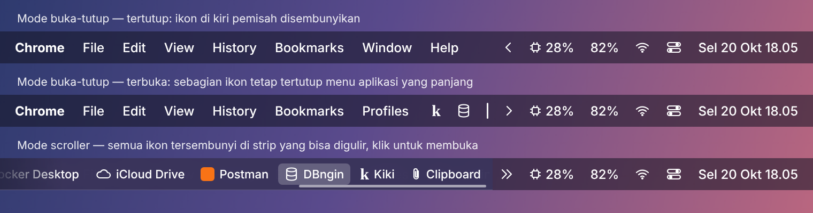
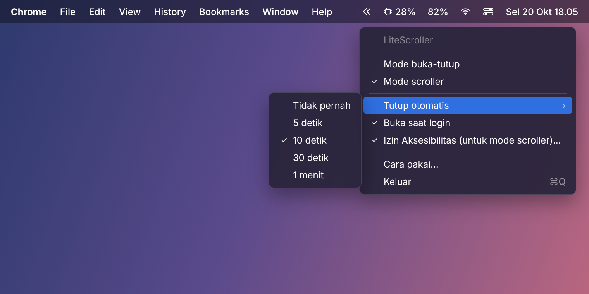

# LiteScroller

Pemisah (separator) **ringan** untuk menu bar macOS, untuk merapikan menu bar yang penuh ikon.
Mirip Hidden Bar, tapi punya **mode scroller**: ikon yang tersembunyi tetap bisa dijangkau
walau menu aplikasi (teks di kiri) terlalu panjang atau terhalang notch.
Dibuat dengan Swift + AppKit murni, satu file sumber, tanpa dependensi.





> Gambar di atas adalah mockup. Tampilan asli bisa sedikit berbeda.

## Fitur

- **Mode buka-tutup**: ikon di kiri pemisah `|` disembunyikan / ditampilkan dengan sekali klik `‹`
- **Mode scroller**: klik `«` untuk menampilkan strip di atas menu bar berisi **semua** ikon tersembunyi.
  Gulir dengan trackpad atau roda mouse, lalu klik ikon untuk membukanya
- **Mode dropdown**: klik `⌄` untuk menampilkan daftar semua ikon tersembunyi sebagai menu
  (gambar ikon + nama), lalu klik salah satu untuk membukanya
- Tutup otomatis setelah 5 / 10 / 30 / 60 detik (atau tidak pernah)
- Buka saat login
- Ikon otomatis mengikuti tema terang/gelap
- Hemat sumber daya: tidak ada polling, CPU 0% saat diam (hanya cek pembaruan sehari sekali)
- Update ke versi terbaru langsung dari menu
- Uninstall langsung dari menu

## Kenapa ada mode scroller?

Pemisah biasa (Hidden Bar, dsb.) hanya memanjang untuk mendorong ikon keluar layar.
Saat dibuka, ikon-ikon itu kembali ke menu bar — tapi kalau menu aplikasi aktif panjang
(mis. Chrome: *File, Edit, View, History, Bookmarks, Profiles, Tab, Window, Help*) atau
layarnya ber-notch, macOS tetap menyembunyikan sebagian ikon. Tidak ada cara untuk menjangkaunya.

Di mode scroller, ikon tetap disembunyikan di menu bar. Strip yang muncul **menimpa** area menu
aplikasi, jadi ruangnya jauh lebih lebar, dan kalau masih tidak cukup, strip itu bisa digulir.

## Cara pakai

Setelah dijalankan, di menu bar muncul dua item: `|` (pemisah) dan `‹` (tombol).

1. Tahan **⌘** lalu seret ikon yang ingin disembunyikan ke **kiri** pemisah `|`.
   Ikon di antara `|` dan `‹` selalu terlihat.
2. Klik `‹` untuk membuka / menutup (atau membuka strip di mode scroller / daftar di mode dropdown).
3. Klik kanan `‹` (atau ⌥-klik, atau klik `|`) untuk pengaturan: pilih mode, tutup otomatis, buka saat login.

### Izin Aksesibilitas (khusus mode scroller & dropdown)

Mode scroller & dropdown membaca daftar ikon menu bar dan "menekan" ikon yang Anda klik lewat
Accessibility API macOS, jadi butuh izin:
**Pengaturan Sistem → Privasi & Keamanan → Aksesibilitas → aktifkan LiteScroller**.
LiteScroller akan membuka halaman itu otomatis saat mode scroller / dropdown dipilih.

Mode buka-tutup **tidak** butuh izin apa pun.

### Izin Rekam Layar (opsional, mode scroller & dropdown)

Supaya strip / daftar dropdown menampilkan **gambar asli** tiap ikon (sama persis seperti di menu bar), beri izin
**Pengaturan Sistem → Privasi & Keamanan → Rekam Layar & Audio Sistem → aktifkan LiteScroller**
(atau klik kanan `‹` → **Izin Rekam Layar…**). LiteScroller hanya memotret jendela ikon menu bar,
bukan isi layar lain. Tanpa izin ini strip menampilkan ikon aplikasi (atau nama item kalau ikonnya tidak ada).

> Karena aplikasi ditandatangani ad-hoc, setelah update / build ulang macOS bisa menganggapnya
> aplikasi baru. Kalau strip menampilkan pesan izin padahal sudah dicentang, hapus LiteScroller
> dari daftar Aksesibilitas (tombol −) lalu tambahkan lagi.

### Batasan

- Tanpa izin Rekam Layar, strip menampilkan ikon aplikasi (atau nama item), bukan gambar asli ikonnya.
- Gambar asli ikon dipotret langsung walau ikonnya sedang tersembunyi (di luar layar), lewat API privat
  macOS `CGSHWCaptureWindowList`. Kalau gagal, dipakai gambar terakhir yang tersimpan, lalu ikon aplikasinya.
- Saat ikon di strip diklik, LiteScroller membuka pemisah sebentar lalu menekan ikon aslinya,
  sehingga menu / popover aplikasi itu muncul di posisinya. Setelah beberapa detik pemisah tertutup lagi.
- Di dropdown, judul item memakai nama aplikasinya (judul asli item tampil sebagai tooltip).
  Item milik proses sistem (Control Center, dsb.) memakai nama itemnya.

## Instalasi

**Opsi A: unduh `.app` jadi (tanpa Xcode)**

1. Unduh `LiteScroller.zip` dari halaman [Releases](../../releases).
2. Ekstrak, lalu pindahkan `LiteScroller.app` ke folder **Applications**.
3. Karena aplikasi belum ditandatangani Apple, hapus tanda karantina sekali saja:
   ```bash
   xattr -cr /Applications/LiteScroller.app
   open /Applications/LiteScroller.app
   ```

**Opsi B: installer (compile di Mac sendiri)**

Butuh Xcode Command Line Tools. Installer akan menawarkan pemasangan kalau belum ada.

```bash
bash ~/Downloads/install-LiteScroller.command
```

**Opsi C: build dari source**

```bash
git clone https://github.com/kikiraihan/mac-os-lite-menu-bar-scroller.git
cd mac-os-lite-menu-bar-scroller
./scripts/build.sh
cp -R build/LiteScroller.app /Applications/
```

## Update

Klik kanan `‹` → **Cek pembaruan…**. LiteScroller mengecek rilis terbaru di halaman Releases GitHub
(otomatis juga saat dibuka dan sehari sekali; kalau ada versi baru, judul menu berubah jadi
**Update tersedia: vX…**). Pilih **Update sekarang**: file `LiteScroller.zip` diunduh, `LiteScroller.app`
lama diganti, lalu aplikasi dibuka lagi. Pengaturan tetap tersimpan.

> Karena aplikasi ditandatangani ad-hoc, setelah update izin Aksesibilitas (mode scroller & dropdown) mungkin perlu diberikan ulang.

Kalau aplikasi dijalankan dari folder yang tidak bisa ditulis (atau langsung dari Downloads),
halaman rilis dibuka supaya Anda bisa mengunduh manual.

## Uninstall

Klik kanan `‹` → **Uninstall LiteScroller…**. Ikon yang tersembunyi tampil lagi, LiteScroller dihapus dari
"Buka saat login" dan daftar izin Aksesibilitas & Rekam Layar, pengaturannya dihapus, lalu `LiteScroller.app` dipindahkan ke Tong Sampah.

Atau manual lewat Terminal:

```bash
pkill -x LiteScroller
rm -rf /Applications/LiteScroller.app
tccutil reset Accessibility id.local.litescroller
tccutil reset ScreenCapture id.local.litescroller
defaults delete id.local.litescroller
```

## Struktur repo

```
LiteScroller/
├── Sources/LiteScroller/main.swift  # seluruh kode aplikasi
├── Resources/Info.plist             # metadata bundle (.app)
├── scripts/
│   ├── build.sh                     # build → build/LiteScroller.app
│   └── make-installer.sh            # buat dist/install-LiteScroller.command
├── docs/screenshots/                # gambar untuk README
└── .github/workflows/build.yml      # build otomatis di macOS + rilis
```

## Rilis

**Otomatis:** naikkan versi di `Resources/Info.plist` (`CFBundleShortVersionString`, mis. `1.1` → `1.2`),
lalu merge ke `main`. GitHub Actions akan build, membuat tag `v1.2`, dan rilis berisi `LiteScroller.zip` dan
`install-LiteScroller.zip`. Kalau versinya tidak diubah, merge hanya di-build tanpa rilis baru.

**Manual:** push tag versi, maka GitHub Actions akan build lalu melampirkan `LiteScroller.zip` dan `install-LiteScroller.zip` ke halaman Releases:

```bash
git tag v1.0.0 && git push origin v1.0.0
```

## Syarat

macOS 13 (Ventura) atau lebih baru. Mendukung Apple Silicon dan Intel.
